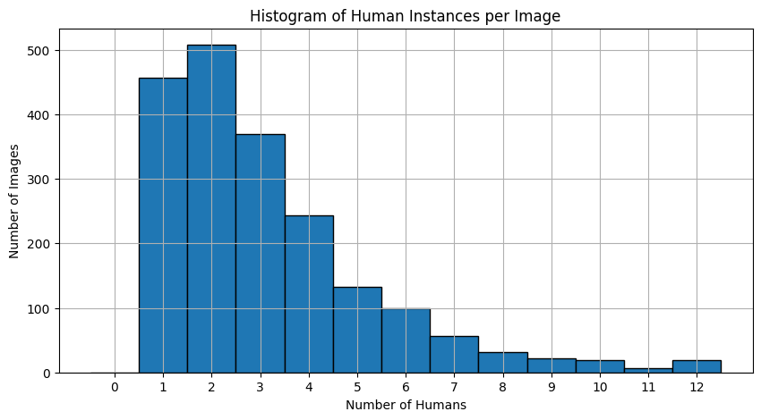
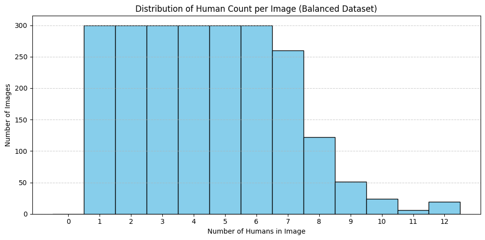
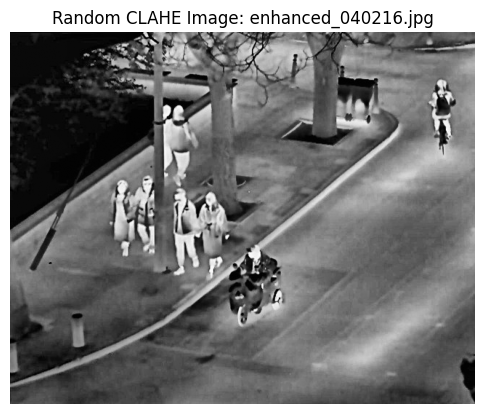

# Thermal-Image Human Detection: Dataset Preparation

Ordinary camera-based person detectors fail in darkness and smoke. Thermal cameras still see people in those conditions. This project prepares a thermal-image dataset (YOLO format, one class: `person`) so that a detector can be trained on it.

The notebook covers data sampling, class-count balancing, contrast enhancement, augmentation and export. It does not contain model training.

## Pipeline ([`thermal_human_detection_preprocessing.ipynb`](thermal_human_detection_preprocessing.ipynb))

1. **Load:** CLAHE-enhanced thermal frames with YOLO label files (one line per person).
2. **Explore:** count the people in each image. On a random sample of 1,966 labeled images there are 3.13 people per image on average (median 3, max 12, std 2.18).
3. **Balance by crowd size:** busy scenes are rare, so a random sample is dominated by images with 1 to 3 people. Two strategies were tried:
   - bin images by the square root of the person count and take 150 per bin
   - cap each count from 1 to 12 at 300 images

   The second one gave the final set: 2,282 images with a much flatter count distribution.
4. **Contrast enhancement:** CLAHE (clip limit 2.0, 8x8 tiles), plus a pixel-intensity check that compares person regions (from the boxes) with the background.
5. **Augmentation:** Albumentations (brightness and contrast, blur, gamma, CLAHE, flip). One augmented copy is kept for each image.
6. **Export:** image and label pairs are uploaded to Roboflow and exported in COCO format, ready for detector training.

| Random sample | After balancing |
|---|---|
|  |  |



## Running it

The notebook was written for Google Colab. The dataset is pulled from Google Drive and is not included in this repo. The Roboflow step needs your own key:

```python
import os
os.environ["ROBOFLOW_API_KEY"] = "<your key>"
```

`data.yaml` holds the YOLO dataset config (train / val / test paths, 1 class).

## Team

Group project by Hrishikesh Muniraju, Trisha Annambhotla and Ameesha Talukdar. The original shared repository is [Trisha-Annambhotla/Thermal-image-human-detection](https://github.com/Trisha-Annambhotla/Thermal-image-human-detection).
